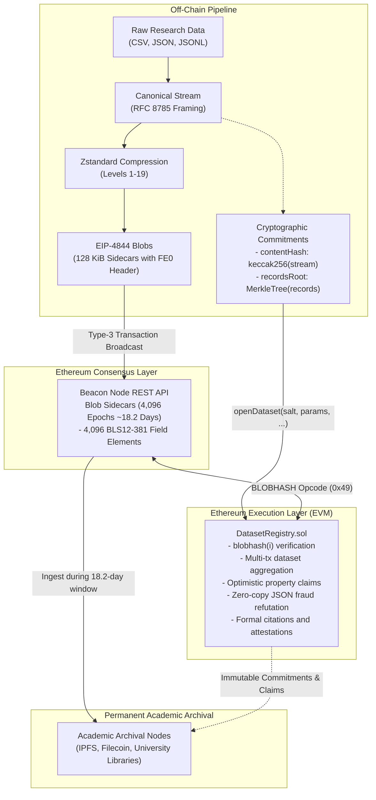

# research-blob-da

[](https://github.com/samudragupto/research-blob-da/actions/workflows/ci.yml)
[](LICENSE)
[](contracts/)
[](python/)
[-orange.svg)](foundry.toml)

**Author:** Arrhat Nag ([@samudragupto](https://github.com/samudragupto))

**Verifiable, Cheap Data Availability for Scientific Datasets, ML Training Traces, and Academic Archives via Ethereum EIP-4844 Blobs.**

---

## For Conference Reviewers

This repository contains the complete open-source prototype, Foundry contracts, formal cost models, and empirical benchmark suite for the research paper *research-blob-da*.

- **Headline Findings (Defensible & Verified):**
  1. **27.8x Theoretical Cost Reduction vs. Standard Calldata:** Under documented economic assumptions (15 gwei execution base fee, 2 gwei blob base fee, $3,000 USD/ETH), posting a 1.0 MiB theoretical uncompressed dataset costs **$27.24** on EIP-4844 blobs versus **$755.92** on standard calldata cost, 4 gas per zero byte and 16 gas per non-zero byte, before application of the EIP-7623 floor.
  2. **12.1x Measured Compressed Cost on an ML Training Trace:** A synthetic ML training trace of 1,056.1 KiB compresses 6.04x to 174.9 KiB and requires 2 blobs, giving a measured 12.1x cost reduction against posting the compressed payload as standard calldata under the stated fee assumptions ($10.71 vs. $129.91).
  3. **73.2% EVM Gas Reduction for Batch Audits:** On-chain contiguous subtree range proofs (`MerkleLib.sol`) reduce verification gas for 8 consecutive records from 97,200 gas down to 26,050 gas.
- **One-Command Reproduction:**
  ```bash
  forge test && pytest -v tests && python python/experiments.py && python python/plot_results.py && python python/check_consistency.py
  ```
- **Documentation & Review Links:**
  - Academic Paper: [docs/RESEARCH.md](docs/RESEARCH.md)
  - Experimental Methodology: [docs/METHODOLOGY.md](docs/METHODOLOGY.md)
  - Implementation Takeaways: [docs/ENGINEERING_LESSONS.md](docs/ENGINEERING_LESSONS.md)
  - Two-Minute Demonstration Script: [docs/DEMO_VIDEO_SCRIPT.md](docs/DEMO_VIDEO_SCRIPT.md)
  - Ethresearch Discussion Draft: [docs/ETHRESEARCH_POST.md](docs/ETHRESEARCH_POST.md)
  - Generated Benchmark CSVs: [benchmarks/](benchmarks/)
- **Sepolia Testnet Status:** Deployed and verified on Ethereum Sepolia (see [docs/SEPOLIA_DEPLOYMENT.md](docs/SEPOLIA_DEPLOYMENT.md) and [`deployments/sepolia_deployment.json`](deployments/sepolia_deployment.json)).

---

## 1. Executive Summary

Empirical research in machine learning, computational biology, climate science, and distributed systems faces a severe reproducibility crisis. Centralized cloud storage links decay over time, while posting primary empirical artifacts to immutable blockchain storage has historically been economically impossible.

**research-blob-da** introduces an open-source protocol and reference implementation repurposing Ethereum's **EIP-4844 ephemeral data blobs** as a cheap, high-throughput, and cryptographically verifiable primitive for empirical research artifacts.

### Key Contributions
- **Canonical Serialization & Packing:** Deterministic RFC 8785 JSON streaming with conservative 31-byte field element modulus packing (`FE31`), guaranteeing that all 4,096 elements remain strictly below the BLS12-381 scalar field modulus.
- **On-Chain Dataset Registry:** `DatasetRegistry.sol` anchors records Merkle roots, content hashes, and versioned hashes read directly from the Cancun `BLOBHASH` opcode (`0x49`).
- **Optimistic Property Verification:** Researchers post statistical claims (e.g., loss bounds, sensor ranges); challengers can refute invalid claims on-chain in a single transaction using our zero-copy assembly parser `JsonFieldLib.sol`.
- **Dual-Horizon Preservation:** Reconciles the consensus layer's 4,096-epoch (~18.2 day) blob pruning window with long-term academic preservation by defining an off-chain bridge protocol for archival nodes.

---

## 2. Architecture Overview



---

## 3. Empirical Cost and Performance Benchmarks

All benchmark figures below are generated directly from executed code and committed datasets via `python/experiments.py`.

### 3.1 Table A: Theoretical Uncompressed Cost Baseline

> [!NOTE]
> **Table A: Theoretical Uncompressed Cost Baseline.** Calldata cost is the standard calldata calculation (16 gas per non-zero byte and 4 gas per zero byte plus intrinsic and stated execution gas), before application of the EIP-7623 floor. This makes the reported blob savings factor conservative for data-heavy transactions under current post-Pectra rules, because the EIP-7623 floor can raise the effective calldata cost. See Section 6 (Post-Pectra Calldata Floor Sensitivity) for the floor-adjusted analysis.
>
> **Assumptions:** Uncompressed raw data; usable payload per blob is strictly 126,945 bytes (4096 field elements * 31 bytes minus 31-byte FE0 header). Execution base fee: 15 gwei; blob base fee: 2 gwei; ETH price: $3,000 USD.
>
> **SSTORE Caution:** SSTORE figures represent a theoretical mathematical extrapolation (22,100 gas per 32-byte slot) and are **not executable as a single transaction**. At the 30M block gas limit, publishing 1.0 MiB via SSTORE would require at least 25 full Ethereum blocks.

| Dataset Size | Raw Bytes | Blobs Needed | Blob Cost (USD) | Standard Calldata Cost (USD, Pre-Floor) | Blob Savings vs Calldata | Theoretical SSTORE (USD)* | Min Blocks (SSTORE at 30M Gas) |
| :--- | :--- | :--- | :--- | :--- | :--- | :--- | :--- |
| **0.125 MiB** | 131,072 | 2 | $10.7079 | $95.32 | **8.9x** | $4,074.42 | 4 blocks |
| **1.0 MiB** | 1,048,576 | 9 | $27.2379 | $755.92 | **27.8x** | $32,588.72 | 25 blocks |
| **5.0 MiB** | 5,242,880 | 42 | $105.1651 | $3,775.82 | **35.9x** | $162,939.83 | 121 blocks |
| **20.0 MiB** | 20,971,520 | 166 | $397.9827 | $15,100.44 | **37.9x** | $651,756.47 | 483 blocks |

### 3.2 Table B: Measured Compressed Dataset Results

> [!NOTE]
> **Assumptions:** Canonical record serialization, Zstandard level 3 compression, and 31-byte field element packing (FE31). Blob counts, monetary costs, and compression ratios reflect canonical payload bytes actually compressed and posted. Calldata costs represent standard calldata before application of the EIP-7623 floor.

| Dataset Name | Type | Records | Canonical Payload Size | Compressed Size | Ratio | Blobs | Blob Cost (USD) | Calldata Cost (USD) | Savings | Encoding Time (Mean ± Std, N=10) |
| :--- | :--- | :--- | :--- | :--- | :--- | :--- | :--- | :--- | :--- | :--- | :--- |
| **ML Training Trace (JSON)** | Synthetic Dataset | 10,000 | 1056.1 KiB | 174.9 KiB | 6.04x | **2** | .7079 | .91 | **12.1x** | 207.0 ms ± 3.7 ms |
| **Climate Station Data (CSV)** | Synthetic Dataset | 20,000 | 3051.4 KiB | 403.1 KiB | 7.57x | **4** | .4307 | .14 | **19.3x** | 423.4 ms ± 11.3 ms |
| **Genomics Variants** | Synthetic Dataset | 8,000 | 946.0 KiB | 163.0 KiB | 5.80x | **2** | .7079 | .14 | **11.3x** | 139.8 ms ± 0.7 ms |
| **Academic Metadata (JSON)** | Synthetic Dataset | 5,000 | 825.4 KiB | 74.1 KiB | 11.13x | **1** | .3464 | .61 | **6.7x** | 100.9 ms ± 2.4 ms |
| **OpenAlex Academic Works** | Real Dataset | 500 | 207.5 KiB | 50.3 KiB | 4.13x | **1** | .3464 | .01 | **4.6x** | 11.7 ms ± 0.2 ms |

> **Note on the OpenAlex row:** The committed source file is 264,057 bytes (257.9 KiB). The pipeline parses it, extracts the documented record fields, and deterministically canonicalizes the records before compression. The canonical payload actually compressed and encoded is 212,517 bytes (207.5 KiB). Compression ratio, blob count, and cost are therefore calculated from canonical payload bytes.

### 3.3 Explanatory Note on Table A vs Table B Blob Counts

Reviewers comparing Table A and Table B will note that a **1.0 MiB theoretical uncompressed dataset requires 9 blobs**, whereas the **synthetic ML training trace (1,056 KiB canonical payload) requires only 2 blobs**.

This divergence is solely due to compression:
1. **Theoretical Uncompressed Baseline (Table A):** Assumes theoretical uncompressed data. With usable body payload capacity of 126,945 bytes/blob (4,096 elements * 31 bytes minus 31-byte header), posting 1,048,576 uncompressed bytes requires $\lceil 1,048,576 / 126,945 \rceil = \mathbf{9\text{ blobs}}$.
2. **Measured Compressed Results (Table B):** The synthetic ML training trace contains recurring structured keys and floating-point coordinates that Zstandard compresses with a 6.04x ratio, reducing 1,081,484 canonical payload bytes to 179,112 compressed bytes. Chunking into 126,945-byte payload slots yields $\lceil 179,112 / 126,945 \rceil = \mathbf{2\text{ blobs}}$.

---

## 4. Blob Capacity, Transaction Limits, and Block Inclusion Times

Under Ethereum consensus rules, blob throughput is subject to target and maximum block limits. The table below models minimum transactions, burst blocks, and inclusion times across protocol eras.

> [!IMPORTANT]
> These figures represent theoretical best-case lower bounds assuming exclusive block occupancy. In production, blocks are shared with rollups and other blob market participants.

| Dataset Size | Case Type | Blobs | Protocol Era | Min Txs | Burst Blocks | Burst Time (12s) | Target Blocks | Target Time (12s) |
| :--- | :--- | :--- | :--- | :--- | :--- | :--- | :--- | :--- |
| **128 KiB** | Theoretical Uncompressed | 2 | Cancun (EIP-4844) | 1 | 1 | 12s | 1 | 12s |
| **1.0 MiB** | Theoretical Uncompressed | 9 | Cancun (EIP-4844) | 2 | 2 | 24s | 3 | 36s |
| **1.0 MiB** | Theoretical Uncompressed | 9 | Pectra (EIP-7691) | 1 | 1 | 12s | 2 | 24s |
| **1.0 MiB** | Theoretical Uncompressed | 9 | PeerDAS (EIP-7594 Projection) | 1 | 1 | 12s | 1 | 12s |
| **5.0 MiB** | Theoretical Uncompressed | 42 | Cancun (EIP-4844) | 7 | 7 | 84s | 14 | 168s |
| **5.0 MiB** | Theoretical Uncompressed | 42 | Pectra (EIP-7691) | 5 | 5 | 60s | 7 | 84s |
| **20.0 MiB** | Theoretical Uncompressed | 166 | Cancun (EIP-4844) | 28 | 28 | 336s | 56 | 672s |
| **1.0 MiB Raw (6x Zstd)** | Measured Compressed | 2 | Cancun (EIP-4844) | 1 | 1 | 12s | 1 | 12s |

---

## 5. Fee Sensitivity and Break-Even Analysis

The cost advantage of blobs varies with execution base fees ($P_{\text{base}}$) and blob base fees ($P_{\text{blob}}$). Setting the blob posting cost equal to standard calldata cost yields the break-even blob base fee:

> **Calldata Basis:** Standard calldata costs in this sensitivity grid are calculated using standard pre-floor calldata gas (16 gas per non-zero byte, 4 gas per zero byte), making the reported savings ratios conservative under post-Pectra rules for data-heavy transactions.

$$P_{\text{blob}}^{\text{break-even}} = \frac{21,000 + 16 \times S - \text{Gas}_{\text{exec}}}{K \times 131,072} \times P_{\text{base}}$$

For a 1.0 MiB dataset ($S = 1,048,576$, $K = 9$, $\text{Gas}_{\text{exec}} = 448,000$), the break-even coefficient is $\approx 13.86$.

| Execution Base Fee | Blob Base Fee | Standard Calldata Cost | Blob Posting Cost | Savings Ratio | Operating Status |
| :---: | :---: | :---: | :---: | :---: | :--- |
| **15 gwei** | **1 gwei** | $755.92 | $23.70 | **31.90x** | Baseline (Normal Blob Market) |
| **15 gwei** | **2 gwei** | $755.92 | $27.24 | **27.75x** | Documented Baseline |
| **15 gwei** | **10 gwei** | $755.92 | $55.55 | **13.61x** | Moderate Congestion |
| **15 gwei** | **50 gwei** | $755.92 | $197.11 | **3.84x** | High Congestion |
| **15 gwei** | **100 gwei** | $755.92 | $374.05 | **2.02x** | Severe Congestion |
| **15 gwei** | **200 gwei** | $755.92 | $727.95 | **1.04x** | Near Break-Even (207.9 gwei) |
| **50 gwei** | **2 gwei** | $2,519.73 | $74.28 | **33.92x** | Elevated Execution Base Fee |
| **50 gwei** | **100 gwei** | $2,519.73 | $421.09 | **5.98x** | Elevated Congestion |

---

## 6. Post-Pectra Calldata Floor Sensitivity (EIP-7623)

EIP-7623, activated with Pectra, defines an execution-layer calldata floor that raises the effective gas cost of data-heavy transactions whose execution gas is small relative to their calldata size [EIP-7623](https://eips.ethereum.org/EIPS/eip-7623). The official specification defines:

$$\text{Tokens} = (\text{Zero Bytes} \times 1) + (\text{Non-Zero Bytes} \times 4)$$
$$\text{Floor Gas} = 21{,}000 + 10 \times \text{Tokens}$$
$$\text{Gas Used} = 21{,}000 + \max(\text{Standard Calldata Gas} + \text{Execution Gas}, 10 \times \text{Tokens})$$

For data-availability transactions with minimal execution gas:
- **All-Zero Bytes:** Each zero byte costs $1\text{ token} \times 10 = 10\text{ gas/byte}$.
- **All Non-Zero Bytes (Compressed Data):** Each non-zero byte costs $4\text{ tokens} \times 10 = 40\text{ gas/byte}$.
- **Mixed Data:** A 50/50 mixture yields an effective floor of $25\text{ gas/byte}$.

Under post-Pectra rules, a pure data-posting transaction with low execution gas will usually be charged at or near the EIP-7623 floor rather than the standard calldata cost, so the effective calldata cost for this workload is higher than the Table A baseline and the blob cost advantage is larger than the conservative Table A factor. The magnitude depends on the zero and non-zero byte composition of the specific payload and on the execution gas of the transaction.

Because the measured compressed payload is over 99.6% non-zero bytes, its effective EIP-7623 floor is approximately 39.88 gas per byte. Post-Pectra calldata costs for pure DA increase by approximately 2.5x, further widening the economic advantage of blobs. Detailed vectors and calculations are in `benchmarks/calldata_eip7623_sensitivity.csv`.

---

## 7. Testnet Deployment Status

- **Network:** Ethereum Sepolia, Chain ID 11155111
- **DatasetRegistry Contract:** [`0x238dE56E52A3F6C6708952052e6a20E5102b4d5b`](https://sepolia.etherscan.io/address/0x238dE56E52A3F6C6708952052e6a20E5102b4d5b#code) (Verified on Etherscan).
- **Deployment Transaction:** [`0xa55af2b2a6ec29cc706bd8e5ebc166d6ae3130002c183f7ebdbb8186cc834751`](https://sepolia.etherscan.io/tx/0xa55af2b2a6ec29cc706bd8e5ebc166d6ae3130002c183f7ebdbb8186cc834751) (Block 12006103)
- **Live EIP-4844 Blob Transaction:** [`0x9631459f3ee3c26a2113ec9e5d9aee06dc1107435f387596c95a5fd912c7f7ea`](https://sepolia.etherscan.io/tx/0x9631459f3ee3c26a2113ec9e5d9aee06dc1107435f387596c95a5fd912c7f7ea)
- **Dataset ID:** `0x4f7b50bd684170f2c427d8975ee6478fadbc46918b764f1e8a4915374bf9d29b`
- **KZG Versioned Hash:** `0x010e6c7880a790abbedd746b98b713b5780e8e662d9f57f31cc51671b01faf11`
- **Blob Inclusion Block:** 12006195
- **Blob Gas Used:** 131,072
- **Records Root:** `0x6120e0c2e0712d0eca82b57aa8581dd02cbbb3bddf8136b7976aa63421544064`
- **Content Hash:** `0x46b91d8c2a4535a190e8f36f551cdb6f32512dbc1e5b802bb3320aca167ff686`
- **Retrieval Verification:** Retrieval verified on 2026-10-27 16:28:44 UTC from the local cache: the blob sidecar was retrieved, the dataset was reconstructed, and the reconstructed canonical-payload SHA-256 matched the manifest. (Independent consensus retrieval from public Sepolia beacon nodes encountered upstream gateway errors 500/400, and the public Blobscan Sepolia indexer was lagging at block 11,818,175, ~188k blocks behind live block 12,006,195; the Blobscan link is omitted per protocol criteria).
- **Deployment Record:** [deployments/sepolia_deployment.json](deployments/sepolia_deployment.json)

---

## 8. Quickstart and Reproduction

```bash
# Clone repository
git clone https://github.com/samudragupto/research-blob-da.git
cd research-blob-da

# Setup Python environment
python -m venv .venv
source .venv/bin/activate  # On Windows: .venv\Scripts\activate
pip install -r python/requirements.txt

# Run Foundry and Pytest test suites
forge test
pytest -v tests

# Regenerate benchmarks, figures, and verified tables
python python/experiments.py
python python/plot_results.py

# Verify repository consistency and zero-emoji policy
python python/check_consistency.py
```

---

## 9. License

This project is licensed under the [MIT License](LICENSE).
